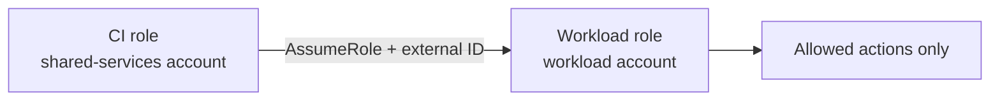

# terraform-cross-account-ci-role

CI should not hold long-lived access keys for other accounts. This module creates
one IAM role in a workload account that a single CI role from the shared-services
account can assume. Access needs an external ID, lasts one hour, and is limited to
the actions and resources you list.



## Usage

```hcl
module "ci_role" {
  source = "github.com/example-org/terraform-cross-account-ci-role"

  ci_role_arn = "arn:aws:iam::123456789012:role/ci-runner"
  external_id = var.external_id # keep it in a secret store

  allowed_actions = ["s3:GetObject", "s3:ListBucket"]
  resource_arns = [
    "arn:aws:s3:::example-artifacts",
    "arn:aws:s3:::example-artifacts/*",
  ]

  tags = { team = "platform" }
}
```

Outputs: `role_arn`, `role_name`. No policy is attached until `resource_arns` is set.

## Limits

- No permission boundary and no SCP check.
- The external ID is only as secret as its storage.
- No MFA requirement, because CI cannot use MFA.
- Partial wildcards such as `s3:Get*` are allowed. Only `*` and `service:*` are blocked.

## Checks

```
terraform fmt -check
terraform init -backend=false
terraform validate
terraform test
```
